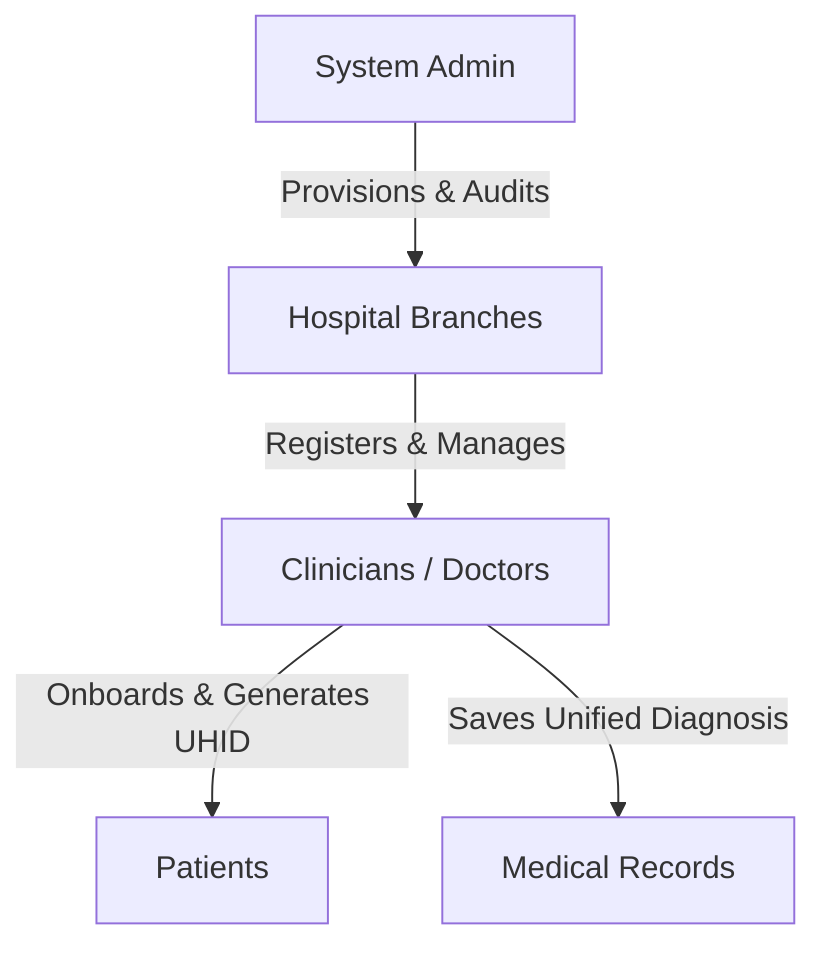
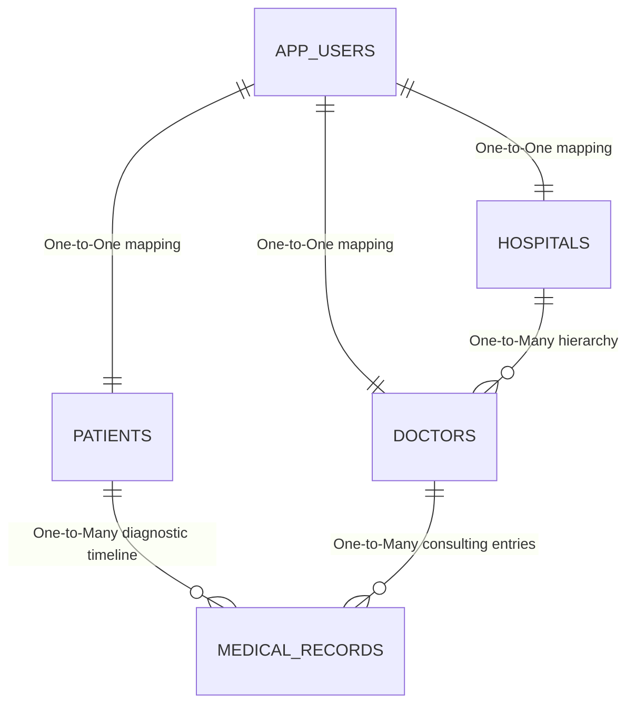

# MediLink: Unified Healthcare & Patient Record Platform

**MediLink** is a next-generation, high-performance web application designed to eliminate healthcare records fragmentation. It connects patients, doctors, and hospitals under a secure, unified digital portal. Featuring a strict organizational hierarchy, real-time clinical registration, automated unique medical identifiers, and a glassmorphic dashboard UI, MediLink represents a modern, production-grade clinical information system.

---

## 🌟 Key Product Features

### 1. Multi-Tier Healthcare Hierarchy
MediLink operates under a strict, real-world hierarchical permission tree to prevent unauthorized accounts and secure patient data:



*   **System Admin**: Pre-seeded on application startup. Holds master privileges to register active Hospital organizations onto the network.
*   **Hospital Branches**: Onboarded by the Admin. Log in to register and manage Doctors working at their specific medical facility.
*   **Clinicians (Doctors)**: Registered by their parent Hospital. Log in to register walk-in Patients and record diagnostic histories.
*   **Patients**: Onboarded exclusively by active Doctors. Access a dedicated portal to view their lifelong medical records.

### 2. Auto-Generated Unique Health Identifiers (UHID)
*   When a doctor registers a patient, the system automatically generates a permanent, cryptographically sound **UHID** (e.g., `ML-A1B2C3D4`).
*   This UHID serves as the single source of truth across all hospitals on the MediLink network, allowing instantaneous profile lookups and records synchronization.

### 3. Dynamic Clinical Records Resolution
*   When a doctor logs a medical record (Diagnosis & Prescription), the backend automatically resolves the doctor's linked Hospital name from the database.
*   This avoids hardcoding or manual entry errors, ensuring the patient's timeline shows exactly which clinician treated them and at which facility.

### 4. High-End Glassmorphic User Interface
*   **Vibrant Mesh Backdrops**: Employs animated backdrop layers that slowly breathe (`scale` and `translate` keyframe loops) to keep the portal engaging.
*   **Glassmorphism Theme**: Translucent cards utilizing extensive CSS blur filters (`backdrop-filter: blur(24px)`) and subtle border highlights.
*   **Shimmer Interactions**: Interactive buttons feature sweeping reflective shine effects on hover, alongside 3D translation lifts for lists and timelines.
*   **Holographic UHID Badges**: Neon-glowing digital containers styled with monospace lettering to look premium.
*   **Custom Toast System**: Native browser alerts are completely handled via a sleek, custom-designed sliding glass Toast Notification manager.

---

## 🛠️ Technology Stack & Architecture

### **Frontend (Client-Side)**
*   **Core**: HTML5, CSS3 (Custom Properties / CSS Variables, Advanced Grid & Flexbox, Custom Keyframes).
*   **Logic & Routing**: Vanilla JavaScript (Modular ES6 Architecture). Single-Page Application (SPA) reactive routing handles view switches without page reloads.
*   **UI Assets**: Custom-designed, glowing inline SVG vector graphics (perfectly transparent, zero load-latency).

### **Backend (Server-Side)**
*   **Framework**: Spring Boot 3.2.3 (Java 17).
*   **API Layer**: Spring Web (REST controllers with structured DTO serialization).
*   **Persistence Layer**: Spring Data JPA.
*   **ORM**: Hibernate.

### **Database**
*   **Engine**: PostgreSQL (Production) / H2 In-Memory (Test environment).
*   **Hosting**: Supabase Cloud Database Cluster.
*   **Pooling**: HikariCP (High-efficiency database connection pooling).

---

## 📊 Database Schema & Relationships



1.  **`AppUser`**: Stores user authentication credentials (`username`, `password`, and role: `ADMIN`, `HOSPITAL`, `DOCTOR`, `PATIENT`).
2.  **`Patient`**: Maps to an `AppUser`. Stores demographic details (`name`, `age`, `bloodGroup`) and holds the unique `uhid`.
3.  **`Hospital`**: Maps to an `AppUser`. Stores institutional branch details (`name`, `address`).
4.  **`Doctor`**: Maps to an `AppUser`. Stores clinical details (`name`, `specialization`) and maintains a `@ManyToOne` join relationship to the parent `Hospital`.
5.  **`MedicalRecord`**: Represents individual clinical logs. Links directly to a `Patient` and a `Doctor`, dynamically recording diagnosis dates and treatment prescriptions.

---

## 🧪 Testing Suite (JUnit 5)

The project includes a robust test suite comprising **24 automated unit and integration tests** built using JUnit 5. To ensure tests execute safely and quickly without modifying the production database, all tests run against an isolated **H2 in-memory database**.

### Configuration
The test configuration is defined in `src/test/resources/application.properties` and replaces the production PostgreSQL database settings with H2:
```properties
spring.datasource.url=jdbc:h2:mem:testdb;DB_CLOSE_DELAY=-1;MODE=PostgreSQL;DATABASE_TO_UPPER=false
spring.datasource.driverClassName=org.h2.Driver
spring.jpa.database-platform=org.hibernate.dialect.H2Dialect
spring.jpa.hibernate.ddl-auto=create-drop
```

### Coverage Details

#### 1. Database Seeding Tests (`DatabaseSeederTest.java`)
*   `testAdminSeededWhenNoAdminExists`: Verifies the default admin credentials (`admin`/`admin123`) are seeded on startup.
*   `testAdminNotSeededWhenAdminAlreadyExists`: Ensures existing admin records are not duplicated or overwritten.

#### 2. Authentication & Onboarding Tests (`AuthControllerTest.java`)
*   **Login Operations**: Verifies login and credentials response mapping for `ADMIN`, `PATIENT`, `DOCTOR`, and `HOSPITAL` users, as well as failure scenarios for invalid credentials.
*   **Patient Registration**: Assures correct patient onboarding, unique UHID allocation, and username uniqueness checks.
*   **Doctor Registration**: Validates doctor creation with or without hospital branch attachments, alongside username uniqueness checks.
*   **Hospital Registration**: Assures correct registration of hospital organizations and checks for username conflicts.
*   **Data Lookup**: Tests fetching all hospital entities and querying doctor lists within a specific hospital entity.

#### 3. Medical Records Tests (`RecordControllerTest.java`)
*   **Records Retrieval**: Validates fetching medical history records sorted by descending timestamp.
*   **Patient Lookup**: Tests patient search capabilities by UHID.
*   **Record Creation**: Tests adding medical logs and resolves the doctor name and parent hospital name automatically.
*   **Error Boundaries**: Verifies handling of non-existent patient UHIDs and unknown doctor entries.

### How to Run Tests
To compile and execute the test suite, run the following Maven command in the project root:
```bash
mvn test
```

---

## 🚀 Running the Application

### Prerequisites
*   Java Development Kit (JDK) 17 or higher
*   Maven 3.x
*   PostgreSQL / Supabase account (configured in `src/main/resources/application.properties`)

### Execution
1.  Verify the PostgreSQL URL and credentials in `src/main/resources/application.properties`.
2.  Start the Spring Boot backend application:
    ```bash
    mvn spring-boot:run
    ```
3.  Access the web interface at `http://localhost:8080`.
